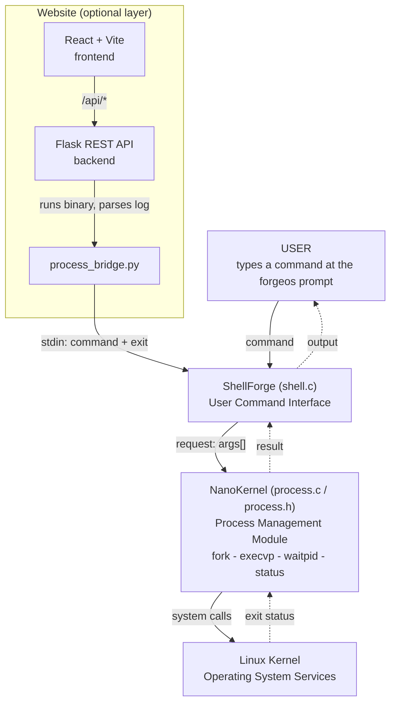
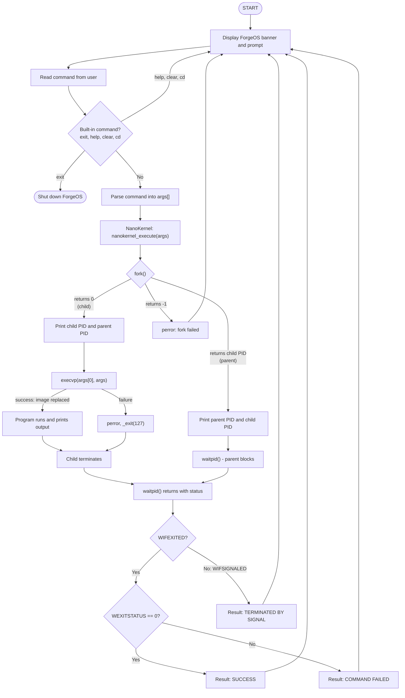
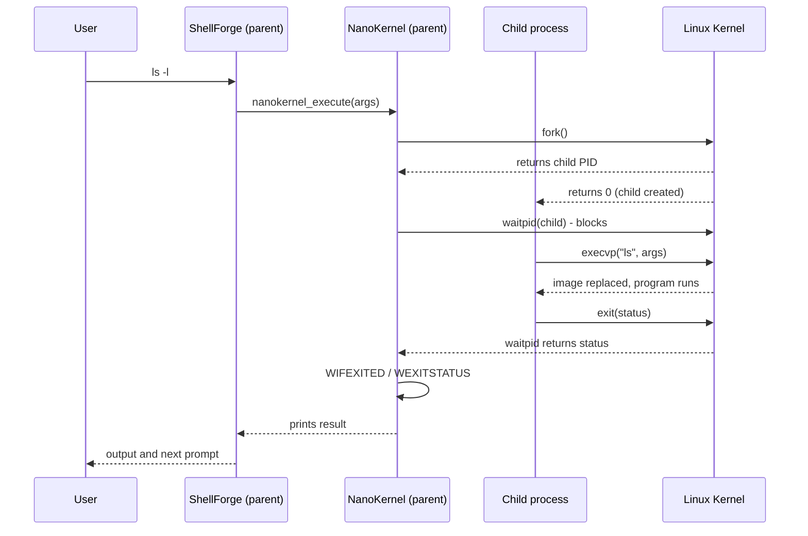

<div align="center">

# ForgeOS

### Linux Process Creation, Execution and Termination System

**Create. Execute. Synchronize. Terminate.**

A working demonstration of the Linux process life cycle: a C command shell that really performs `fork()` → `execvp()` → `waitpid()`, plus a React + Flask control center that visualizes every run.


</div>

---

## Table of Contents

- [Project Overview](#project-overview)
- [Features](#features)
- [Screenshots](#screenshots)
- [Project Architecture](#project-architecture)
- [Project Folder Structure](#project-folder-structure)
- [Technologies Used](#technologies-used)
- [System Calls Explained](#system-calls-explained)
- [Installation and Execution](#installation-and-execution)
- [Working Principle](#working-principle)
- [Sample Output](#sample-output)
- [Website Backend API](#website-backend-api)
- [Security Design](#security-design)
- [Team Members](#team-members)
- [Learning Outcomes](#learning-outcomes)
- [Future Enhancements](#future-enhancements)
- [Conclusion](#conclusion)

---

## Project Overview

### What is ForgeOS?

**ForgeOS** is a small, readable Linux system-programming project written in C. It is a command shell that runs every command you type inside a **new child process** and prints a step-by-step trace of what the operating system is doing: process creation, program execution, synchronization, and termination.

ForgeOS is built from layers that mirror a real system:

| Layer | Role |
|---|---|
| **ShellForge** (`shell.c`) | The user command interface: banner, prompt, input parsing, built-in commands |
| **NanoKernel** (`process.c` / `process.h`) | The project's own process-management module: `fork()`, `execvp()`, `waitpid()`, status reporting |
| **Linux Kernel** | The real operating system underneath, which performs the system calls |

> **Note:** NanoKernel is *this project's* process-management module. It is not the Linux kernel. The real Linux kernel underneath does the actual work.

On top of the C program sits a **web control center** (React + Flask). For every click, the Flask backend starts the real compiled `forgeos` binary, feeds it one validated command, and parses what NanoKernel printed. Nothing on the website is simulated.

### Why was it developed?

Process creation, execution, synchronization, and termination are normally taught with diagrams and short code fragments. The system calls are hidden inside commands students use every day (`ls`, `pwd`, `date`), so the ideas stay abstract.

### What problem does it solve?

Students rarely see the **whole** process life cycle running as one connected system. ForgeOS makes it visible:

- The printed **PID** and **PPID** values show the parent-child relationship.
- The **"Parent waiting for child..."** line shows synchronization.
- The final **status report** shows termination, exit status, and result.

### Why does fork-exec-wait matter?

`fork()` + `execvp()` + `waitpid()` is the foundation of every Linux shell. Bash, service managers, and many system utilities launch programs this way, so understanding it transfers directly to real-world systems programming.

```text
Parent (ShellForge/NanoKernel)                Child
        │
        │── fork() ──────────────────────────►  copy of parent (new PID)
        │                                        │
        │── waitpid()  (parent blocks)           │── execvp()  (image replaced by the command)
        │                                        │── command runs
        │                                        └── exit(status)
        │◄── status retrieved ───────────────────┘
        ▼
  WIFEXITED / WEXITSTATUS  →  SUCCESS or COMMAND FAILED
```

---

## Features

Every feature below exists in the source code in this repository.

### C implementation (terminal)

| Feature | Details |
|---|---|
| **Interactive ForgeOS shell** | Banner, prompt showing the current directory (`forgeos:<cwd>$`), `help`, `exit`, and `clear` |
| **Linux command execution** | Any executable found on `PATH` runs through NanoKernel |
| **Parent and child process creation** | Each command runs in a new child created with `fork()` |
| **Program execution** | The child's image is replaced using `execvp()` |
| **Process synchronization** | The parent blocks in `waitpid()` until the child ends |
| **PID and PPID identification** | Parent and child print their IDs with `getpid()` / `getppid()` |
| **Exit-status detection** | `WIFEXITED`, `WEXITSTATUS`, `WIFSIGNALED`, `WTERMSIG` |
| **Success and failure reporting** | Result is `SUCCESS`, `COMMAND FAILED`, or `TERMINATED BY SIGNAL` |
| **exec failure handling** | If `execvp()` fails, the child reports the error and exits with status `127` |
| **Built-in `cd`** | Handled inside ShellForge using `chdir()`, because a child process cannot change its parent's directory |
| **Built-in `help`** | Lists command categories (navigation, files, search, system info, permissions, process management, editors) |

### Website (React + Flask)

| Page | What it does |
|---|---|
| **Dashboard** | Totals for executions, successes, failures, last child PID, last exit status, plus the last execution and a "How a command travels" chain |
| **Execute Process** | Pick a command and arguments, run it for real, and watch a 9-stage, two-lane (parent/child) lifecycle visualization |
| **Process Lifecycle** | Interactive diagram: click `fork()`, `execvp()`, `waitpid()`, or Exit Status for an explanation, code snippet, live facts from the last run, and a process tree |
| **Process Monitor** | Table of every child process (PID, PPID, command, state, exit status, result) with a selectable process tree |
| **Terminal** | A ForgeOS terminal in the browser with command history (arrow keys), `help`, and `clear` |
| **Execution History** | Time, command, PID, exit status, and result of each run, with a Clear History button |
| **OS Concepts** | Cards explaining fork, execvp, waitpid, PID, PPID, exit status, WIFEXITED, WEXITSTATUS, and PCB, with live facts from the last run |
| **About Project** | Project, course, and team details, and the architecture summary |

Additional website behavior:

- **Stage visualization is evidence-based.** A lifecycle stage lights up only if it appears in the real NanoKernel log.
- **Backend status indicator** ("NanoKernel bridge online") in the sidebar, with an offline banner if Flask is not running.
- **Persistent history** saved by the backend in `backend/data/history.json` (last 200 runs).
- **Collapsible sidebar** and reduced-motion support.

---

## Screenshots

### Dashboard


The Control Center home page. The top strip shows total, successful, and failed executions along with the last child PID and exit status. **Last execution** shows the command, parent PID, child PID, child PPID, process state, normal termination, exit status, and result. **How a command travels** shows the path *User → ShellForge → NanoKernel → Linux Kernel*.

### Execute Process


Choose a command and click **CREATE & EXECUTE PROCESS**. The page runs the real C program, then replays the nine lifecycle stages found in the NanoKernel log across two lanes: the **parent** (Request, Fork, Waiting, Status Retrieved, Complete) and the **child** (Child Created, Exec, Running, Terminated).

### Process Lifecycle


An interactive flowchart of `USER COMMAND → ShellForge → NanoKernel → fork()`, which splits into the **parent** path (`waitpid()` → WAIT) and the **child** path (`execvp()` → EXECUTE PROGRAM → TERMINATE), and rejoins at **EXIT STATUS → RESULT**. Clicking a system call shows its explanation, code, and facts from the last run.

### Process Monitor


Every child process ForgeOS has created, listed with its PID, PPID, command, state, exit status, and result. Selecting a row draws its **process tree**: ForgeOS → parent process (calls `fork()`, then `waitpid()`) → child process → the program loaded by `execvp()`.

### Execution History


A log of real executions only, showing time, command, child PID, exit status, and result. The history can be cleared with **Clear History**.

---

## Project Architecture



### Component responsibilities

| Component | File(s) | Responsibility |
|---|---|---|
| **User** | n/a | Types commands at the `forgeos` prompt and reads the results |
| **ShellForge** | `shell.c` | Prints the banner and prompt, reads a line with `fgets()`, splits it with `strtok()`, handles built-ins (`exit`, `help`, `clear`, `cd`), and calls NanoKernel |
| **NanoKernel** | `process.c`, `process.h` | Exposes `nanokernel_execute(char *args[])`. Creates the child (`fork`), runs the program (`execvp`), synchronizes (`waitpid`), interprets the status, and prints the result |
| **Linux Kernel** | n/a | Provides the real OS services: process table, scheduling, memory, and program loading |
| **React frontend** | `frontend/` | The browser UI: dashboard, visualizations, terminal, history |
| **Flask backend** | `backend/app.py` | REST API and history storage |
| **Process bridge** | `backend/process_bridge.py` | Validates commands, builds/launches the `forgeos` binary, and parses the NanoKernel log into structured data |

---

## Project Folder Structure

The C modules live in `NanoKernel/` and `Shellforge/`; the website lives in `backend/` and `frontend/`. All of it sits inside `ForgeOS/`.

```text
SystemForge_OSSP/
├── README.md                      ← this file
├── assets/
│   └── screenshots/
│       ├── dashboard.png
│       ├── execute-process.png
│       ├── process-lifecycle.png
│       ├── process-monitor.png
│       └── execution-history.png
└── ForgeOS/
    ├── NanoKernel/
    │   ├── process.h              interface of the process module
    │   └── process.c              fork / execvp / waitpid / status reporting
    ├── Shellforge/
    │   ├── shell.c                command interface and main loop
    │   └── forgeos                compiled executable (produced by gcc)
    ├── backend/
    │   ├── app.py                 Flask REST API + history storage
    │   ├── process_bridge.py      runs the real C binary and parses its output
    │   ├── requirements.txt       Flask, Flask-CORS
    │   └── data/                  history.json is created here at runtime
    ├── frontend/
    │   ├── index.html
    │   ├── package.json
    │   ├── package-lock.json
    │   ├── vite.config.js         dev server on 5173, proxies /api to Flask
    │   └── src/
    │       ├── main.jsx
    │       ├── App.jsx            page routing, health check, shared state
    │       ├── index.css
    │       ├── pages/             Dashboard, Execute, Lifecycle, Monitor,
    │       │                      Terminal, History, Concepts, About
    │       ├── components/        Sidebar, StageRail, LifecycleDiagram,
    │       │                      ProcessTree, ProcessInfo, ui
    │       ├── services/api.js    fetch wrapper for the Flask API
    │       └── lib/               stages.js (9 stages), concepts.js (OS concepts)
    ├── README.md                  website setup notes
    └── run.sh                     helper: setup | backend | frontend | all
```

### What each part does

| Path | Purpose |
|---|---|
| `NanoKernel/` | The process-management module. Contains all `fork()`, `execvp()`, and `waitpid()` logic |
| `Shellforge/` | The user-facing shell. Compiling it together with `process.c` produces the `forgeos` executable |
| `process.h` | Declares `int nanokernel_execute(char *args[]);`, the only function ShellForge needs |
| `process.c` | Implements the full life cycle: creation, execution, synchronization, termination report |
| `shell.c` | Banner, prompt, input parsing, built-in commands, and the call into NanoKernel |
| `frontend/` | React 18 + Vite single-page app (the website UI) |
| `backend/` | Flask API that safely runs the real C binary on behalf of the website |
| `run.sh` | Convenience script for setup and starting the servers |

> `Shellforge/forgeos` is a build output. It is regenerated by the `gcc` command in [Installation and Execution](#installation-and-execution), and the backend also recompiles it automatically if it is missing or older than the sources.

---

## Technologies Used

| Technology | Where it is used | Why |
|---|---|---|
| **C** | `shell.c`, `process.c`, `process.h` | The native language of Linux system calls and POSIX |
| **GCC** (`-Wall -Wextra`) | Compiling the two C modules into `forgeos` | Standard Linux compiler with extra warnings enabled |
| **Linux / Ubuntu (or WSL)** | Runtime environment | `fork()`/`execvp()`/`waitpid()` are POSIX calls, unavailable on native Windows |
| **POSIX system calls** | `unistd.h`, `sys/types.h`, `sys/wait.h` | Process creation, execution, synchronization, status |
| **Python 3** | `backend/` | Runs the API and bridge |
| **Flask ≥ 3.0** | `backend/app.py` | REST API |
| **Flask-CORS ≥ 4.0** | `backend/app.py` | Allows `localhost` / `127.0.0.1` origins |
| **React 18** | `frontend/src/` | Component-based UI |
| **Vite 5** | `frontend/` | Dev server, build tool, and `/api` proxy |
| **lucide-react** | Sidebar and page icons | Icon set |
| **JavaScript (JSX)** and **CSS** | `frontend/src/` | UI logic and styling |
| **Google Fonts** | `frontend/index.html` | Chakra Petch, IBM Plex Sans, JetBrains Mono (loaded from the web) |
| **stdbuf** (GNU coreutils) | `process_bridge.py` | Keeps C output line-buffered when it is piped to Flask |
| **Git / GitHub** | Version control | Team collaboration |

---

## System Calls Explained

### Process calls

| Call | Header | Used in | What it does |
|---|---|---|---|
| `fork()` | `<unistd.h>` | `process.c` | Creates a new process by duplicating the caller. It returns **the child's PID to the parent**, **0 to the child**, and **-1 on failure**. That return value is how each process knows which one it is |
| `execvp(file, argv)` | `<unistd.h>` | `process.c` | Replaces the current process image with a new program. Searches `PATH` and takes arguments as an array. The PID does not change. If it succeeds it **never returns**; if it returns, an error occurred |
| `waitpid(pid, &status, 0)` | `<sys/wait.h>` | `process.c` | Blocks the parent until the given child terminates, then stores the packed termination status. It also reaps the child so no zombie remains |
| `getpid()` | `<unistd.h>` | `process.c` | Returns the PID of the calling process |
| `getppid()` | `<unistd.h>` | `process.c` | Returns the PID of the calling process's parent. For the child, this equals the parent's PID |
| `getcwd()` | `<unistd.h>` | `shell.c` | Gets the current directory for the `forgeos:<cwd>$` prompt |

Also used: `chdir()` for the built-in `cd`, `_exit(127)` when `execvp()` fails, and `perror()` for error messages.

### Status macros

`waitpid()` packs several facts into one integer. These macros unpack it:

| Macro | Meaning | In ForgeOS |
|---|---|---|
| `WIFEXITED(status)` | True if the child ended **normally** (returned from `main` or called `exit`) | Prints `Normal termination : YES` |
| `WEXITSTATUS(status)` | The child's 8-bit exit code. Valid only when `WIFEXITED` is true | `0` → `SUCCESS`, non-zero → `COMMAND FAILED` |
| `WIFSIGNALED(status)` | True if the child was **killed by a signal** | Prints `Normal termination : NO` |
| `WTERMSIG(status)` | The number of the signal that killed the child. Valid only when `WIFSIGNALED` is true | Printed on the `Signal` line, result `TERMINATED BY SIGNAL` |

Exit-code convention: `0` means success; any other value means the program reported a problem. NanoKernel uses `127` when `execvp()` cannot start the program.

---

## Installation and Execution

All commands are for **Ubuntu Linux** (native or WSL). The repository is named `SystemForge_OSSP`.

### 1. Install dependencies

```bash
sudo apt update
sudo apt install -y git gcc python3 python3-venv python3-pip nodejs npm
node -v        # must be v18 or newer
```

If `node -v` shows a version older than 18:

```bash
curl -fsSL https://deb.nodesource.com/setup_20.x | sudo -E bash -
sudo apt install -y nodejs
```

### 2. Clone the repository

```bash
git clone https://github.com/iliharshika/SystemForge_OSSP.git
cd SystemForge_OSSP/ForgeOS
```

> The team members' repositories are listed under [Team Members](#team-members).

### 3. Option A: run only the C program (terminal)

```bash
cd Shellforge
gcc -Wall -Wextra shell.c ../NanoKernel/process.c -o forgeos
./forgeos
```

Type commands such as `pwd`, `ls -a`, or `date`, `help` for command categories, and `exit` to shut ForgeOS down.

### 4. Option B: run the website (frontend + backend)

**One-time setup** (compiles the C program, creates a Python virtual environment with Flask, installs frontend packages):

```bash
cd ~/SystemForge_OSSP/ForgeOS    # adjust if you cloned elsewhere
chmod +x run.sh
./run.sh setup
```

**Terminal 1: start the backend** (Flask on `http://127.0.0.1:5000`):

```bash
cd ~/SystemForge_OSSP/ForgeOS
./run.sh backend
```

**Terminal 2: start the frontend** (Vite on `http://localhost:5173`):

```bash
cd ~/SystemForge_OSSP/ForgeOS
./run.sh frontend
```

**Open the website:** go to **http://localhost:5173** in your browser. The sidebar should show a green **NanoKernel bridge online** indicator. On WSL, open the URL in your Windows browser; `localhost` is forwarded automatically.

Manual equivalents of the two `run.sh` commands:

```bash
# backend
cd backend && source .venv/bin/activate && python app.py

# frontend
cd frontend && npm run dev
```

`./run.sh all` starts the backend in the background and the frontend in the foreground.

### Troubleshooting

| Problem | Fix |
|---|---|
| "Backend offline" banner | Start the backend (Terminal 1) and keep it running |
| `ensurepip` / venv error | `sudo apt install -y python3-venv` |
| Port 5000 or 5173 busy | `ss -ltnp \| grep -E '5000\|5173'`, then stop the old process |
| gcc error from the backend | Run the gcc command in `Shellforge/` by hand to see the message |
| Node older than 18 | Use the NodeSource commands above |

---

## Working Principle

1. The user enters a Linux command at the `forgeos` prompt (or clicks **Create & Execute Process** on the website).
2. **ShellForge** reads the line with `fgets()`, splits it into `args[]` with `strtok()`, and prints `Command received`.
3. **NanoKernel** receives the request through `nanokernel_execute(args)`.
4. `fork()` creates a **child process**.
5. The child runs the command using `execvp()`, replacing its image with the program.
6. The parent waits using `waitpid()`.
7. The child terminates.
8. The parent retrieves the exit status with `WIFEXITED` / `WEXITSTATUS` (or `WIFSIGNALED` / `WTERMSIG`).
9. ForgeOS displays **SUCCESS**, **COMMAND FAILED**, or **TERMINATED BY SIGNAL**, and control returns to the prompt.



### Parent and child timeline



---

## Sample Output

The traces below were produced by compiling this repository's `shell.c` and `process.c` with the project's gcc command and running them. PIDs and the working directory will differ on your machine.

### 1. Successful command: `pwd`

```text
forgeos:/home/<user>/SystemForge_OSSP/ForgeOS/Shellforge$ pwd

[ShellForge] Command received: pwd 

[NanoKernel] Request received.
[NanoKernel] Creating child process...
[NanoKernel] Parent PID : 132
[NanoKernel] Child PID  : 134
[NanoKernel] Parent waiting for child...
[NanoKernel] Child process created.
[NanoKernel] Child PID  : 134
[NanoKernel] Parent PID : 132
[NanoKernel] Executing using execvp()...
[NanoKernel] Command     : pwd

/home/<user>/SystemForge_OSSP/ForgeOS/Shellforge

[NanoKernel] Child process terminated.
[NanoKernel] Normal termination : YES
[NanoKernel] Exit status         : 0
[NanoKernel] Result              : SUCCESS
```

| Line | Meaning |
|---|---|
| `Parent PID : 132` (first) | The ForgeOS shell process that called `fork()` |
| `Child PID  : 134` | The new process; `fork()` returned this value to the parent |
| `Child PID : 134` / `Parent PID : 132` (after "Child process created") | Printed **by the child** using `getpid()` and `getppid()`. The child's **PPID (132) equals the parent's PID**, which confirms the parent-child relationship |
| `Parent waiting for child...` | The parent is about to block in `waitpid()` |
| `/home/<user>/...` | Output of `pwd`, produced by the program that replaced the child through `execvp()` |
| `Child process terminated.` | `waitpid()` returned |
| `Normal termination : YES` | `WIFEXITED(status)` is true |
| `Exit status : 0` | `WEXITSTATUS(status)` is 0, so the result is **SUCCESS** |

### 2. Failing command: `ls -z`

The program started, but reported an error, so the exit status is non-zero:

```text
[ShellForge] Command received: ls -z 

[NanoKernel] Request received.
[NanoKernel] Creating child process...
[NanoKernel] Parent PID : 136
[NanoKernel] Child PID  : 138
[NanoKernel] Parent waiting for child...
[NanoKernel] Child process created.
[NanoKernel] Child PID  : 138
[NanoKernel] Parent PID : 136
[NanoKernel] Executing using execvp()...
[NanoKernel] Command     : ls

ls: invalid option -- 'z'
Try 'ls --help' for more information.

[NanoKernel] Child process terminated.
[NanoKernel] Normal termination : YES
[NanoKernel] Exit status         : 2
[NanoKernel] Result              : COMMAND FAILED
```

The termination was still **normal** (`YES`), because `ls` exited on its own. The exit status `2` is non-zero, so the result is **COMMAND FAILED**.

### 3. Command that cannot be started: `nosuchcmd`

```text
[ShellForge] Command received: nosuchcmd 

[NanoKernel] Request received.
[NanoKernel] Creating child process...
[NanoKernel] Parent PID : 140
[NanoKernel] Child process created.
[NanoKernel] Child PID  : 142
[NanoKernel] Parent waiting for child...
[NanoKernel] Child PID  : 142
[NanoKernel] Parent PID : 140
[NanoKernel] Executing using execvp()...
[NanoKernel] Command     : nosuchcmd

[NanoKernel] execvp failed: No such file or directory

[NanoKernel] Child process terminated.
[NanoKernel] Normal termination : YES
[NanoKernel] Exit status         : 127
[NanoKernel] Result              : COMMAND FAILED
```

Here `execvp()` returned (which only happens on error), so the child called `_exit(127)`. The parent still collected the status through `waitpid()`.

> The relative order of some parent and child lines can vary between runs, because after `fork()` the two processes run concurrently.

### 4. Child killed by a signal

A child that kills itself with `SIGKILL` (signal 9) is reported through `WIFSIGNALED` / `WTERMSIG`:

```text
[NanoKernel] Child process terminated.
[NanoKernel] Normal termination : NO
[NanoKernel] Signal              : 9
[NanoKernel] Result              : TERMINATED BY SIGNAL
```

### Result summary

| Situation | Normal termination | Exit status | Result |
|---|---|---|---|
| Command succeeds | `YES` | `0` | `SUCCESS` |
| Command runs but reports an error | `YES` | non-zero (e.g. `2`) | `COMMAND FAILED` |
| `execvp()` cannot start the program | `YES` | `127` | `COMMAND FAILED` |
| Child killed by a signal | `NO` | n/a (signal number shown) | `TERMINATED BY SIGNAL` |

---

## Website Backend API

The frontend talks to Flask through the Vite proxy (`/api` → `http://127.0.0.1:5000`).

| Method | Path | Purpose |
|---|---|---|
| `GET` | `/api/health` | Backend and binary status |
| `GET` | `/api/commands` | The allowed commands, with descriptions and examples |
| `POST` | `/api/execute` | Run a command through ForgeOS: `{ "command": "ls", "arguments": ["-l"] }` |
| `GET` | `/api/history` | Past executions and dashboard statistics |
| `GET` | `/api/processes` | The same executions, newest first, for the Process Monitor |
| `POST` | `/api/history/clear` | Clear the history |

`/api/execute` returns the real `parent_pid`, `child_pid`, `child_ppid`, `exit_status`, `result`, `output`, `terminal_output`, and a `stages` object that says which lifecycle steps appeared in the real log.

**How the bridge works:** for each request, `process_bridge.py` starts the compiled `forgeos` binary, writes `<command>` and `exit` to its standard input, and parses the `[ShellForge]` / `[NanoKernel]` lines it prints. When C output goes to a pipe instead of a terminal, glibc buffers `printf`, and `fork()` copies that buffer, which would scramble the log. The bridge therefore launches the binary through `stdbuf -oL -eL` (line-buffered), leaving the C code untouched.

---

## Security Design

The website runs real processes, so the backend restricts what it accepts:

- **Allowlist only:** `pwd`, `ls`, `whoami`, `id`, `hostname`, `date`, `uname`, `uptime`, `df`, `free`, `ps`, `echo`.
- **Per-command argument rules**, for example `ls` accepts only flags such as `-l` or `-la`, so no file paths can be passed.
- **Shell metacharacters rejected:** `; & | < > ` $ ( ) { } [ ] \ " ' * ? ! # ~`, newlines, and control characters.
- **Dangerous commands blocked** by name (for example `rm`, `sudo`, `shutdown`, `reboot`, `kill`, `chmod`, `chown`).
- **No `shell=True`:** arguments are validated and passed to a fixed binary.
- **10-second timeout** per execution.
- **Local only:** the server binds to `127.0.0.1`.

> The allowlist applies to the **website** only. The terminal program (`./forgeos`) runs whatever executable you type, just as a normal shell does, so use it with the same care.

---

## Team Members

| Name | Roll Number | Responsibility |
|---|---|---|
| **Ili Harshika** | 2520030607 | Process creation using `fork()` and handling of the parent-child process relationship |
| **Gurrapu Nikshitha** | 2520030512 | Program execution using `exec()` and process synchronization using `wait()` |
| **Angela Jose** | 2520030365 | Process termination, exit-status handling, and testing of the system |

**Guide / Course Coordinator:** Dr. D. Bheekya, Faculty, Operating Systems and Systems Programming, Department of Computer Science and Engineering, K L (Deemed to be) University.

**Course:** Operating Systems and Systems Programming (25CS2104E), Section 1, Team 7.

**Repositories:**
[iliharshika/SystemForge_OSSP](https://github.com/iliharshika/SystemForge_OSSP) ·
[gurrapunikshitha/SystemForge_OSSP](https://github.com/gurrapunikshitha/SystemForge_OSSP) ·
[angelapvjose92/SystemForge_OSSP](https://github.com/angelapvjose92/SystemForge_OSSP)

---

## Learning Outcomes

Building ForgeOS gave the team practical experience in:

- **Linux process management:** how every command becomes a process with its own PID, state, and address space.
- **Parent-child relationships:** reading PID and PPID values to see the process tree.
- **System calls:** using `fork()`, `execvp()`, `waitpid()`, `getpid()`, `getppid()`, and `getcwd()` directly instead of `system()` or `popen()`.
- **Process synchronization:** using `waitpid()` to block the parent, prevent interleaved output, and avoid zombie processes.
- **Process termination:** telling normal exits from signal kills with `WIFEXITED`, `WEXITSTATUS`, `WIFSIGNALED`, and `WTERMSIG`, and why `127` signals an exec failure.
- **Linux system programming:** modular C with header files, separate compilation, GCC warnings, and the Ubuntu terminal.
- **Frontend and backend integration:** connecting a React interface to a Flask API that safely launches a native C program and turns its text log into structured data, including the buffering issue that appears when output is piped.
- **Secure design:** validating input with an allowlist before running real processes.
- **Teamwork:** Git and GitHub collaboration, testing, documenting, and presenting a systems project.

---

## Future Enhancements

These are ideas for future work. **They are not implemented in the current version.**

- Background execution using `&`.
- Input/output redirection (`<`, `>`).
- Pipes between commands (`|`), which would introduce `pipe()` and `dup2()`.
- Signal handling in the shell (for example, `Ctrl+C`).
- Running several children at once to demonstrate concurrency.
- Other IPC mechanisms: shared memory, message queues, sockets.
- Threads (pthreads) alongside processes.
- Showing `zombie` and `waiting` states in the Process Monitor.
- Automated tests for the C module and the backend parser.

---

## Conclusion

ForgeOS turns one of the most important ideas in operating systems, the process life cycle, into something students can run, watch, and explain. By implementing the classic **fork-exec-wait** model with raw POSIX system calls and printing a trace of every stage, it connects textbook theory with real system-level programming. The layered design (ShellForge, NanoKernel, Linux Kernel) mirrors how real systems are organized, and the React + Flask control center shows the same real execution data visually, with PIDs, PPIDs, states, exit statuses, and results taken from the actual program output.

For learners, ForgeOS is a transparent way to understand how a shell launches commands. For instructors, it is a compact classroom demonstration. For the team, it was a practical exercise in Linux system programming, modular C, and full-stack integration.

---

<div align="center">

**ForgeOS** · Linux Process Creation, Execution and Termination System
K L (Deemed to be) University · Department of Computer Science and Engineering

*Create. Execute. Synchronize. Terminate.*

</div>
